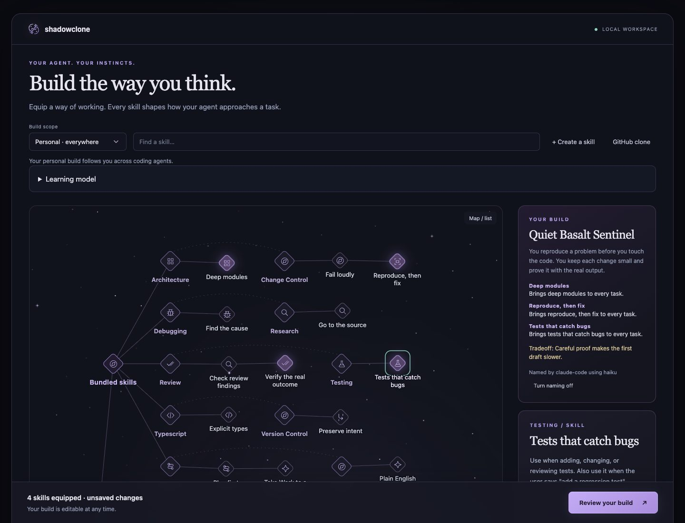
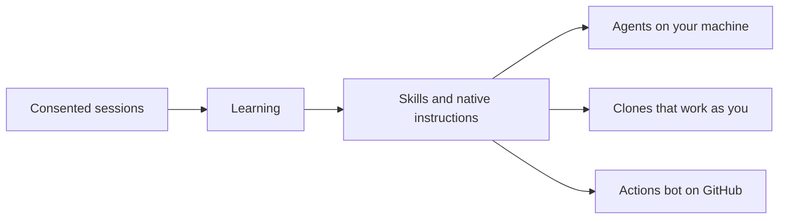

<div align="center">


[](https://www.npmjs.com/package/@shadowclone/cli)
[](https://github.com/theonly1me/shadowclone/actions/workflows/ci.yml)
[](LICENSE)
[](https://hol.org/registry/plugins/theonly1me%2Fshadowclone)

[Quick start](#quick-start) · [Clones](#your-clone-works-while-you-are-away) · [What shadowclone offers](#what-shadowclone-offers) · [Compare](#how-shadowclone-compares-to-other-tools) · [How it works](#how-it-works) · [Eval and Results](#eval-and-results) · [Docs](#docs)

</div>

**shadowclone keeps your engineering preferences the same in every coding agent.** It maintains one set of skills and instructions for Claude Code, Codex, Cursor, Pi, Antigravity, and OpenCode. You do not copy rules from one tool to the next. shadowclone can also learn new preferences from the sessions that you allow.

**It works as you while you are away.** Ask your agent to start a clone. Claude Code or Codex works with your skills, on your own subscription, in Docker on your own machine. It opens a draft pull request as you. shadowclone is not a separate agent. It equips the agent that you already use. See [how it compares to other tools](#how-shadowclone-compares-to-other-tools).

## Quick start

Paste this into Claude Code, Codex, Cursor, Pi, Antigravity, or OpenCode:

```text
Set up shadowclone: https://raw.githubusercontent.com/theonly1me/shadowclone/main/plugins/shadowclone/skills/setup-shadowclone/SKILL.md
```

The agent handles installation and configuration in about 5 minutes. You answer the consent questions and pick skills in the browser:

1. It installs the CLI, and the plugin in Claude Code or Codex.
2. It asks if shadowclone can learn from your past sessions, keep skills in sync, and keep learning in the background.
3. It opens the skill wizard, where you pick skills and select **Equip**.
4. It learns from your past sessions while you pick skills, if you agreed.

<details>
<summary>Install by hand</summary>

```bash
npm install -g @shadowclone/cli
shadowclone init
shadowclone wizard
```

To add the plugin, run `/plugin install shadowclone@shadowclone` after `/plugin marketplace add theonly1me/shadowclone` in Claude Code. In Codex, run `codex plugin marketplace add theonly1me/shadowclone` and then `codex plugin add shadowclone@shadowclone`.

</details>

## What shadowclone offers

### Your clone works while you are away

**Ask, and it works as you.** Tell your agent "start a clone to fix the flaky date parser test", or run `shadowclone clone start`. Claude Code or Codex works with your skills, on your Claude or ChatGPT plan or a key. It stops when its draft pull request has green CI. The pull request shows your name.

```text
$ shadowclone clone start --repo you/app "fix the flaky date parser test"
Queued clone k3x9m2qa for you/app: fix the flaky date parser test
$ shadowclone clone list
k3x9m2qa done you/app shadowclone/k3x9m2qa #43 2026-10-18T14:02:11Z fix the flaky date parser test
```

**Runs on your machine.** Each clone runs in a fresh Docker container on a machine that you own. There is no shadowclone server, and your tokens stay in a file on that machine. Clones never push to the default branch, and each commit names the agent.

**Set it up with one sentence.** Ask your agent to "set up shadowclone clones for this repository." You approve your skills and paste two tokens. See the [clones guide](docs/guides/clones.md).

**Reach them from your phone.** The hub puts your clones behind Tailscale Funnel as an MCP connector. Ask Claude on your phone what your clones are doing, and answer their questions there. See the [hub guide](docs/guides/hub.md).

### Preferences that evolve with your work

**Learn from corrections.** shadowclone reads the sessions you allow and turns reusable instructions into skills and short native guidance. It keeps repository-specific rules in their scope. Rules remain readable, editable, and reversible.

**Keep guidance current.** Background learning reviews new rules after each session. It applies durable guidance when automatic maintenance is on and discards rules that existing guidance covers. You can review and undo each change. See the [learning guide](docs/guides/learning.md).

### Skills and builds you can configure

**Start with a build.** shadowclone includes 15 workflow skills for planning, debugging, implementation, verification, and review. New users can pick skills immediately. Learning from past sessions is optional. Browse the skills in [`skills/`](skills/), or [install them without the CLI](docs/guides/skills.md#install-skills-without-shadowclone).

**Choose where skills apply.** The browser wizard supports a personal build, a private build for one repository, or a shared build that a team commits. The same skills reach all six agents. Pi can use any model it supports. See [Agent builds](docs/guides/agent-builds.md).



### Reviews on your machine and on GitHub

**Review a pull request.** Run a local review with your Claude subscription:

```bash
shadowclone review 123
```

The reviewer combines repository standards, mechanical checks, and code analysis. Findings include evidence checked against the source. The result stays in a local file. Run `shadowclone review --base main` to review committed branch changes before opening a PR.

**Read a guided review.** Equip `guided-pr-review` and `shadowclone-review`, then ask your agent:

```text
Use guided-pr-review to review PRs 1, 2, and 3.
```

The agent creates an HTML guide with actual diffs, behavior traces, and a reading order across the PRs. It supports inline notes and lets the reader reveal agent findings after forming a review. The guide stays local. See [reviews](docs/guides/reviews.md).

**Review in the cloud.** Comment `@<bot> review` on a pull request, also on one from a fork. The Actions bot posts its findings on GitHub under its own identity. See [cloud review](docs/guides/reviews.md#review-in-the-cloud).

### An Actions bot for your team

**Share an agent with your team.** A bot runs in GitHub Actions with your selected skills and one provider API key: Anthropic, OpenAI, an OpenAI-compatible endpoint, or Cursor. Anyone with write access can tag it. It works on issues, opens pull requests, and follows checks and review feedback. You decide when to merge.

**Ask the agent to configure it.** After local setup, ask:

```text
Set up the shadowclone Actions bot here with the account octo-shadow.
```

The agent prepares the skills repository and workflows. Then it gives you one link where you add the bot token and the API key on GitHub. Merge the setup PR, and the agent runs a check. The [Actions bot guide](docs/guides/actions-bot.md) covers providers, setup, and pausing work to continue locally.

**Keep your key on GitHub.** The bot reads the API key from a GitHub environment, and shadowclone never sees it. Anyone with write access can tag the bot, so set a spending limit in your provider console.

## How shadowclone compares to other tools

shadowclone gives one set of skills to the agents that you already use, on your machine and on GitHub. The table uses each project's own pages, checked on 12 October 2026. "Not stated" means that those pages do not answer the question.

| Tool                                                                   | What it is                                                                                   | Agents                                                | Learns from your sessions              | Same guidance in the cloud      | Reviews pull requests                 |
| ---------------------------------------------------------------------- | -------------------------------------------------------------------------------------------- | ----------------------------------------------------- | -------------------------------------- | ------------------------------- | ------------------------------------- |
| shadowclone                                                            | Skills, instructions, learning, and a GitHub Actions bot for the agents that you already use | Claude Code, Codex, Cursor, Pi, Antigravity, OpenCode | Yes, from the sessions that you allow  | Yes, clones and a bot           | Yes, locally, guided, and on GitHub   |
| [pstack](https://github.com/cursor/plugins/tree/main/pstack)           | A skill and principle pack                                                                   | Cursor                                                | No. You run `/reflect` to edit a skill | Not stated                      | Yes, `/interrogate` and Comment Sicko |
| [Hermes Agent](https://github.com/NousResearch/hermes-agent)           | Its own agent with a learning loop                                                           | Hermes only                                           | Yes, it writes skills after tasks      | Yes, on a server with chat apps | Not stated                            |
| [Claude Code auto memory](https://code.claude.com/docs/en/memory)      | Built-in notes from corrections                                                              | Claude Code                                           | Yes, notes from your corrections       | No. Memory stays on one machine | No                                    |
| [Claude Subconscious](https://github.com/letta-ai/claude-subconscious) | A background Letta agent                                                                     | Claude Code                                           | Yes, through a Letta agent             | Not stated                      | No                                    |
| [imprint](https://github.com/n33kos/imprint)                           | A plugin that trains one profile                                                             | Claude Code                                           | Yes, when you run `/imprint:train`     | Not stated                      | No                                    |

Claude Code loads its auto memory beside shadowclone skills, so you can use both. See the [comparison guide](docs/guides/comparison.md) for each tool and its sources.

## How it works



shadowclone indexes references to enabled sessions and copies no transcript. It redacts text and learns rules. One session can give an explicit rule, and an inferred pattern needs three independent sessions. Rules become skills that you can read, edit, and undo. shadowclone changes the guidance, not the model. See the [architecture](docs/architecture/README.md).

## Eval and Results

Across 24 fixed tasks, shadowclone learning scored above existing user skills on all four models. Scores measure preference adherence on synthetic tasks. See [setups, methods, and limits](evals.md).

| Setup                                  | GPT 6.1 Sol | GPT 6 Luna | Claude Sonnet 5.5 | Claude Opus 5.5 |
| -------------------------------------- | ----------: | ---------: | ----------------: | --------------: |
| Agent alone                            |       77.3% |      59.0% |             56.5% |           53.2% |
| Existing user skills                   |       85.2% |      80.6% |             76.4% |           73.6% |
| Existing skills + shadowclone learning |       89.4% |      83.3% |             90.0% |           82.9% |

## Privacy

- **No collection service.** No telemetry. Model work uses the agent CLI that you choose.
- **Consent.** Every source is off by default and has its own setting.
- **Redaction.** Tool results, tool-returned file contents, and thinking blocks never enter learning.
- **Removal.** Run `shadowclone learning disable`, `shadowclone skills automatic off`, or `shadowclone forget --all`.

Read the [privacy policy](PRIVACY.md) and [data handling](docs/data-handling.md).

## Docs

| Guide                                            | Use it to             |
| ------------------------------------------------ | --------------------- |
| [Agent builds](docs/guides/agent-builds.md)      | Pick skills and scope |
| [Learning](docs/guides/learning.md)              | Learn from sessions   |
| [Skill maintenance](docs/guides/skills.md)       | Review updates, undo  |
| [Repository setup](docs/guides/repositories.md)  | Share checks          |
| [Pi setup](docs/guides/pi.md)                    | Use Pi models         |
| [OpenCode setup](docs/guides/opencode.md)        | Use OpenCode          |
| [Delegated work](docs/guides/delegated-work.md)  | Ready a pull request  |
| [Actions bot](docs/guides/actions-bot.md)        | Set up the GitHub bot |
| [Clones](docs/guides/clones.md)                  | Work as you, anywhere |
| [Hub](docs/guides/hub.md)                        | Reach your clones     |
| [Reviews](docs/guides/reviews.md)                | Review a pull request |
| [MCP server](docs/guides/mcp.md)                 | Give agents the tools |
| [Command reference](docs/guides/commands.md)     | Find every command    |
| [Enterprise controls](docs/guides/enterprise.md) | Set scope and policy  |
| [Comparison](docs/guides/comparison.md)          | Compare related tools |

More: [documentation index](docs/README.md), [motivation](docs/motivation.md), [design records](docs/design/README.md), [security](SECURITY.md).

## Contributing

Read [CONTRIBUTING.md](CONTRIBUTING.md) before you open a pull request. shadowclone uses the MIT license. If shadowclone saves you a correction, star the repository.
